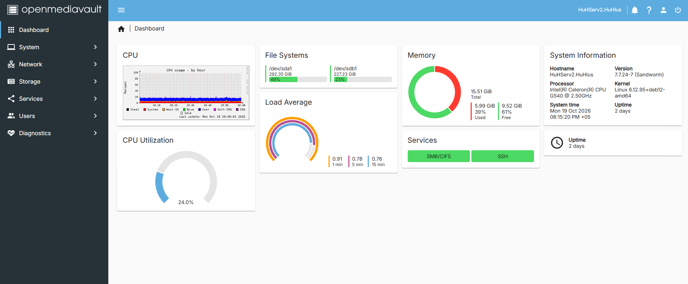
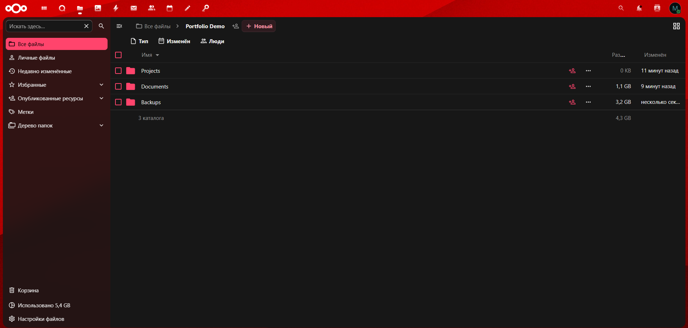
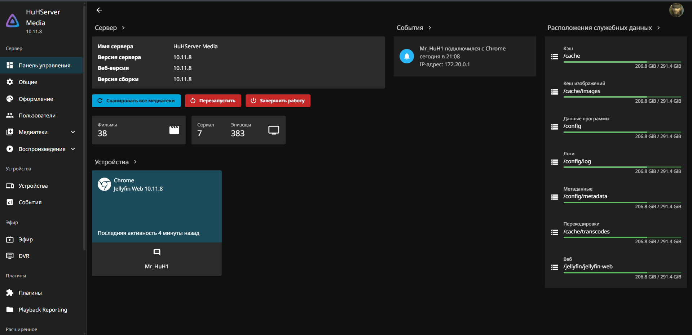
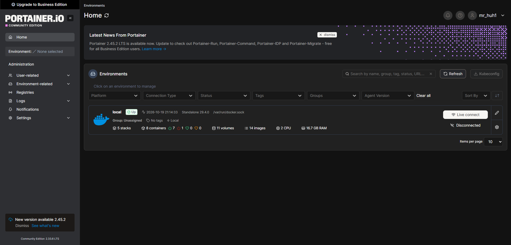

# 🖥️ HomeLab Infrastructure

### Linux Servers | Debian | Docker | OpenMediaVault | Networking

**A personal infrastructure project featuring two physical Linux servers, network storage, containerized applications, and remote access.**

This repository documents my practical experience building, configuring, maintaining, and troubleshooting a self-hosted Linux environment.

The infrastructure is used for file storage, media services, personal cloud applications, and experimentation with server technologies.

---

## 🏗️ Infrastructure Overview

The homelab consists of two physical servers connected to a local network.

| Server | Role | Technologies |
|---|---|---|
| HuHServer | Storage, media and personal cloud | Debian 12, OpenMediaVault, Docker, Jellyfin, Nextcloud |
| HuHServ2 | Applications and development services | Debian 12, OpenMediaVault, Docker Compose, Portainer, Navidrome, Homepage |

Both servers are administered through Linux management tools and remote connections.

## 🛠️ Technology Stack

**Operating Systems**
- Debian GNU/Linux 12
- OpenMediaVault

**Containerization**
- Docker
- Docker Compose
- Portainer

**Networking**
- SSH
- Tailscale
- SMB / Samba
- Local network configuration

**Self-Hosted Applications**
- Jellyfin — media streaming
- Nextcloud — personal cloud storage
- Navidrome — music streaming
- MeTube — media downloading
- Homepage — service dashboard

---

## ⚙️ Implemented Solutions

### 1. Linux Server Deployment

Configured and maintained Linux-based physical servers for everyday self-hosting tasks.

### 2. Docker Container Management

Deployed and managed multiple containerized applications, including configuration of persistent storage, network ports, and service dependencies.

### 3. Network File Sharing

Organized network-accessible storage using OpenMediaVault and SMB for exchanging files between devices.

### 4. Private Network Connectivity

Configured Tailscale to connect devices and provide private remote access to Linux servers.

### 5. Troubleshooting and Maintenance

Performed practical troubleshooting involving containers, network connectivity, storage paths, application configurations, and service availability.

---

## 📚 Technical Documentation

Explore the detailed technical documentation for each server:

- [HuHServer — Storage, Media & Cloud Services](docs/huhserver.md)
- [HuHServ2 — Docker & Application Infrastructure](docs/huhserv2.md)

Documentation includes hardware specifications, operating systems, container deployments and administration details.

---
  

## 📸 Screenshots and Documentation

The following screenshots showcase the deployed infrastructure, storage management, self-hosted cloud services, media server administration, and Docker environment. Additional architecture diagrams and configuration examples are planned.

### OpenMediaVault — HuHServer

### OpenMediaVault — HuHServ2

### Nextcloud — Personal Cloud

### Jellyfin — Media Server

### Docker Management

---

## 🎯 Project Goals

- Gain practical experience in Linux system administration
- Develop reliable self-hosted service deployments
- Improve Docker and networking skills
- Document real technical problems and their solutions
- Build a professional portfolio for freelance server administration

---

## 👨‍💻 Author

**Vyacheslav Sadovsky (MrHuH)**

Linux Server Administration · Docker · Self-Hosting

[GitHub Profile](https://github.com/sadovskijslava)

*Personal homelab project — not a commercial client deployment.*
