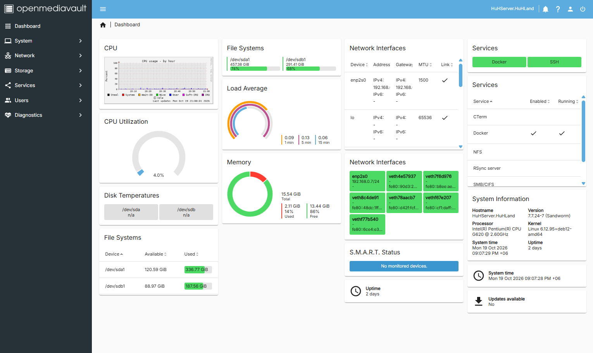
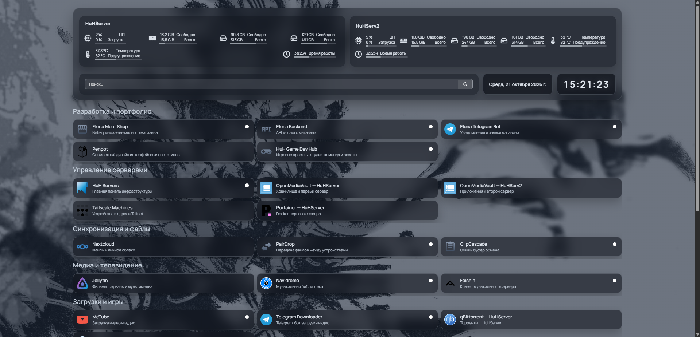

# 🖥️ HomeLab Infrastructure

### Linux Server Administration | Debian | Docker | OpenMediaVault | Networking

**A personal infrastructure project featuring two physical Linux servers, self-hosted applications, containerized services, network storage, and remote access.**

I'm **Vyacheslav Sadovsky (MrHuH)**, an aspiring Linux server administrator from Kazakhstan.

This repository documents my hands-on experience deploying, configuring, maintaining, and troubleshooting Linux-based infrastructure.

My primary areas of interest are **Linux administration, Docker deployments, self-hosting, networking, and infrastructure troubleshooting**.

> **Project status:** Active development  
> **Environment:** Personal homelab  
> **Latest documented inspection:** October 21, 2026  
> **Purpose:** Technical documentation and freelance portfolio

---

## 🏗️ Infrastructure Overview

My homelab consists of two physical Linux servers connected through a local network.

| Server | Primary role | Main technologies |
|---|---|---|
| **HuHServer** | Storage, personal cloud, and media services | Debian 12, OpenMediaVault, Docker, Jellyfin, Nextcloud |
| **HuHServ2** | Containerized applications and development infrastructure | Debian 12, OpenMediaVault, Docker Compose, Homepage, Penpot, Navidrome |

Both servers are managed using Linux command-line tools, SSH, and web-based administration interfaces.

Remote connectivity is provided through Tailscale, with selected applications accessible through Tailscale Serve.

### Infrastructure Highlights

- Two physical Debian-based Linux servers.
- Docker-based deployment and administration.
- **25 running containers on HuHServ2** during the October 21 inspection.
- Self-hosted cloud storage and media applications.
- Multi-container application stacks.
- Private remote access through Tailscale.
- Custom monitoring and service dashboards.
- Technical documentation with screenshots and architecture diagrams.

---

## 🛠️ Technology Stack

| Category | Technologies |
|---|---|
| Operating systems | Debian GNU/Linux 12 |
| Server administration | Linux CLI, SSH, OpenMediaVault |
| Containerization | Docker, Docker Compose, Portainer |
| Networking | Tailscale, Tailscale Serve, SMB/Samba |
| Databases and caching | PostgreSQL, Valkey |
| Monitoring | Homepage, Glances |
| Cloud and file sharing | Nextcloud, PairDrop |
| Media | Jellyfin, Navidrome, Feishin |
| Development infrastructure | Penpot, Game Dev Hub |
| Documentation | Git, GitHub, Markdown, Mermaid |

---

## 🚀 Featured Projects

### 1. HuHServer — Storage, Media & Personal Cloud

HuHServer is the storage-oriented node of my homelab.

It provides network-accessible storage and several self-hosted applications.

**Implemented services include:**

- OpenMediaVault for storage administration.
- Nextcloud for personal cloud storage.
- Jellyfin for media library management and streaming.
- Docker for containerized application deployment.
- SMB for local network file sharing.
- SSH and Tailscale for remote administration.

**[View HuHServer Technical Documentation](docs/huhserver.md)**

### 2. HuHServ2 — Docker Application Infrastructure

HuHServ2 is the application-oriented node of my homelab.

It hosts multiple containerized applications, development tools, supporting databases, and monitoring services.

During the October 21 inspection, the server reported **25 running Docker containers**, including several multi-container deployments.

The infrastructure includes:

- Homepage and Glances for monitoring.
- Penpot for collaborative design.
- Navidrome and Feishin for music services.
- Game Dev Hub and supporting workers.
- PostgreSQL and Valkey.
- File-sharing and download applications.
- Tailscale-based connectivity.

**[View HuHServ2 Technical Documentation](docs/huhserv2.md)**

### 3. Penpot — Self-Hosted Multi-Container Deployment

Penpot 2.17 is deployed on HuHServ2 using seven Docker containers.

The deployment consists of:

| Component | Technology |
|---|---|
| Frontend | Penpot Frontend 2.17 |
| Backend | Penpot Backend 2.17 |
| Database | PostgreSQL 15 |
| Caching and supporting services | Valkey 8.1 |
| Additional services | Exporter, MCP, Mailcatcher |

All seven containers share the `penpot_penpot` Docker bridge network.

The frontend is accessed through **Tailscale Serve using a Tailnet-only HTTPS endpoint on port 9001**.

The technical case study includes container information, port mappings, network inspection, verification results, and an architecture diagram.

**[Read the Penpot Deployment Case Study](docs/penpot-deployment.md)**

**[View Penpot Screenshot](screenshots/huhserv2-penpot-projects.png)**

### 4. Homepage — Custom Infrastructure Dashboard

Homepage is deployed on HuHServ2 as a centralized interface for accessing and monitoring services across both servers.

The dashboard includes:

- Server monitoring widgets.
- Organized application categories.
- Service status indicators.
- Search and navigation tools.
- Links to administration interfaces.

I also customized the dashboard with a **Graphite Glass** visual style using YAML configuration and CSS.

Customizations include translucent cards, dark backgrounds, blur effects, borders, hover effects, and improved text readability.

**[View Additional Homepage Screenshot](screenshots/huhserv2-homepage-services.png)**

---

## ⚙️ Administration and Technical Experience

### Linux Server Administration

Configured and maintained Debian-based physical servers for self-hosted workloads.

Experience includes inspecting system resources, storage configurations, operating system information, and service status.

### Docker and Application Deployment

Deployed and administered Docker workloads, including applications with separate frontend, backend, database, and background worker components.

Performed container inspections, reviewed images and healthcheck results, and examined Docker network and port configurations.

### Storage and File Sharing

Configured network-accessible storage using OpenMediaVault and SMB for sharing files between devices.

### Remote Access and Networking

Configured and used Tailscale for connectivity between servers and client devices.

Documented private application access through Tailscale Serve and distinguished it from publicly accessible Funnel routes.

### Troubleshooting and Maintenance

Investigated issues involving container behavior, networking, storage paths, application configuration, and service availability.

The repository is being expanded with documented troubleshooting cases, including symptoms, diagnosis, corrective actions, and verification.

---

## 📚 Technical Documentation

Detailed technical information is maintained in separate Markdown documents.

| Documentation | Description |
|---|---|
| **[HuHServer](docs/huhserver.md)** | Server hardware, storage, media, and cloud services |
| **[HuHServ2](docs/huhserv2.md)** | Docker workloads, server administration, networking, and application infrastructure |
| **[Penpot Deployment](docs/penpot-deployment.md)** | Seven-container deployment, Docker networking, Tailscale Serve, and architecture diagram |

The documentation contains observed configurations and technical evidence from the personal homelab.

---

## 📸 Screenshots and Technical Evidence

Additional screenshots are available for individual infrastructure components.

| Component | Evidence |
|---|---|
| HuHServer OpenMediaVault | [Dashboard](screenshots/huhserver-omv-dashboard.png) |
| HuHServer storage | [File Systems](screenshots/huhserver-filesystems.png) |
| HuHServ2 OpenMediaVault | [Dashboard](screenshots/huhserv2-omv-dashboard.png) |
| HuHServ2 storage | [File Systems](screenshots/huhserv2-filesystems.png) |
| Docker management | [Container Status](screenshots/huhserv2-docker-containers.png) |
| Portainer | [Administration Interface](screenshots/huhserver-portainer-overview.png) |
| Nextcloud | [Personal Cloud](screenshots/huhserver-nextcloud.png) |
| Jellyfin | [Media Server Administration](screenshots/huhserver-jellyfin-admin.png) |
| Homepage | [Service Dashboard](screenshots/huhserv2-homepage-services.png) |
| Penpot | [Project Dashboard](screenshots/huhserv2-penpot-projects.png) |

Screenshots represent observed application states at the time they were captured.

---

## 🎯 Project Goals

- [x] Deploy and administer two physical Linux servers.
- [x] Establish Docker-based application infrastructure.
- [x] Configure self-hosted storage and media services.
- [x] Implement private connectivity through Tailscale.
- [x] Create a customized infrastructure dashboard.
- [x] Document the Penpot multi-container deployment.
- [ ] Document additional application stacks.
- [ ] Publish more real troubleshooting case studies.
- [ ] Verify and document backup and restore procedures.
- [ ] Expand performance monitoring documentation.
- [ ] Create a complete two-server architecture diagram.
- [ ] Continue developing a professional Linux administration portfolio.

---

## 🔒 Security and Documentation Scope

This repository describes a **personal homelab**, not a production-grade or commercial client deployment.

The documented configurations and verification results do not constitute a security certification, performance benchmark, or uptime guarantee.

Credentials, private keys, access tokens, and other sensitive information should not be included in public documentation.

The infrastructure evolves over time, so historical observations may differ from the current running environment.

---

## 👨‍💻 About Me

**Vyacheslav Sadovsky (MrHuH)**  
Linux Server Administration · Debian · Docker · Self-Hosting · Networking

I'm developing my technical portfolio with a focus on practical Linux server administration, deployment, maintenance, and troubleshooting.

My goal is to apply these skills to real freelance infrastructure projects.

**GitHub:** [sadovskijslava](https://github.com/sadovskijslava)

---

*Personal homelab project — independently maintained and documented.*