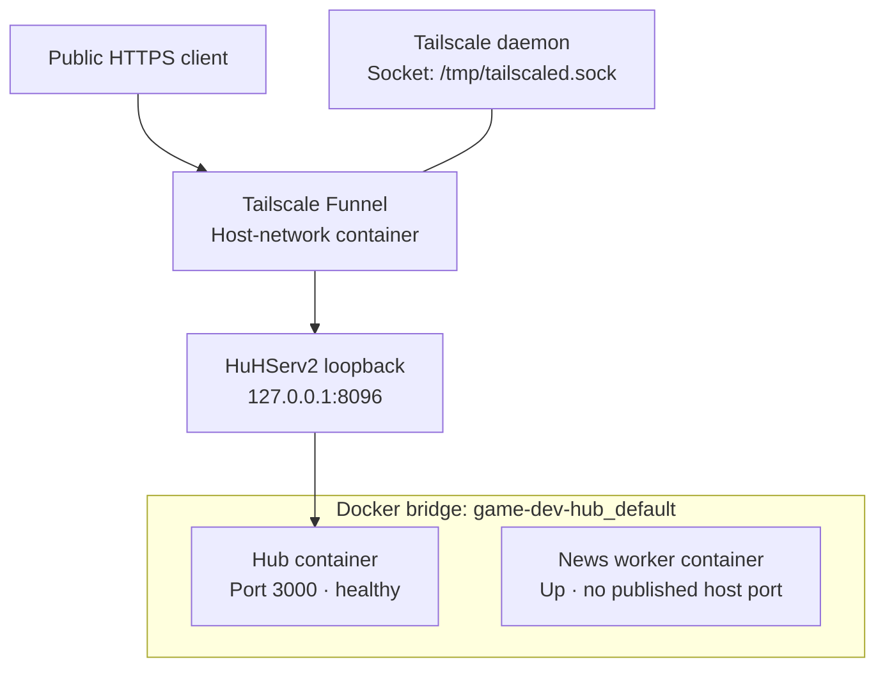
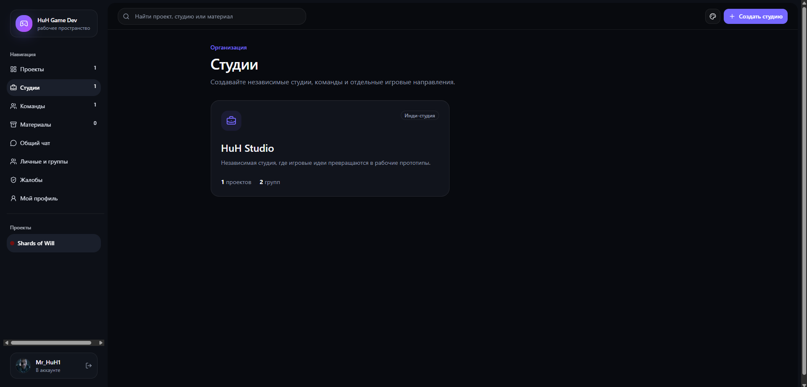

# Game Dev Hub — Docker Application and Tailscale Funnel

> **Project:** Personal homelab  
> **Host:** HuHServ2 (Debian 12)  
> **Documentation snapshot:** October 22, 2026  
> **Scope:** Observed Docker and Tailscale configuration, not a production security or availability certification.

## 1. Overview

Game Dev Hub is a self-hosted application deployed on HuHServ2. Its observed infrastructure includes a web application, a separate background news worker, and a Tailscale container providing an HTTPS Funnel configuration.

This case study documents the observed container states, Docker networks, port publishing, Tailscale routing, and the investigation of a nonstandard Tailscale daemon socket.

## 2. Container Inventory

| Container | Image | Observed state | Docker network |
|---|---|---|---|
| `game-dev-hub-hub-1` | `huh-game-dev-hub:1.0.0` | Up 3 days; **healthy** | `game-dev-hub_default` |
| `game-dev-hub-news-worker-1` | `huh-game-dev-hub:1.0.0` | Up 3 days | `game-dev-hub_default` |
| `game-dev-hub-funnel` | `tailscale/tailscale:stable` | Up 3 days | `host` |

The web application and worker were identified as services `hub` and `news-worker` in the Docker Compose project `game-dev-hub`. The Tailscale container did **not** have Compose project/service labels in the observed inspection.

An `Up` state is not proof that every application feature functions correctly. Only the web application container reported a `healthy` Docker healthcheck in this inspection.

## 3. Docker Networking

- Application network: `game-dev-hub_default`
- Network driver: `bridge`
- `Internal`: `false`
- Web application host mapping: **`127.0.0.1:8096` → container `3000/tcp`**
- Worker: `3000/tcp` was listed, but **no host port was published**
- Tailscale container: `host` networking, restart policy `unless-stopped`

The application and worker share a Docker bridge network. Their precise application-level communication paths were not tested and are not assumed by the architecture diagram.

## 4. Public HTTPS Routing via Tailscale Funnel

A separately running Tailscale daemon inside `game-dev-hub-funnel` was found connected to the Tailnet. Its Serve/Funnel configuration reported:

```text
Public HTTPS endpoint (hostname withheld)
  / → http://127.0.0.1:8096
Funnel: on
```

Because the Tailscale container uses `host` networking, this loopback target refers to the host network namespace. Docker then forwards the request to the Hub container's port `3000`.

**Important security distinction:** Tailscale **Funnel** publishes a service to the public internet, unlike Tailnet-only **Serve**. The observed configuration confirms the public route is enabled; external reachability, application authentication, authorization, and security hardening have **not** yet been independently verified.

### Observed architecture



The diagram shows verified network membership and routing, not unverified calls between the worker and the Hub.

## 5. Troubleshooting: Tailscale Socket Discovery

**Symptom:** Initial `tailscale serve status` and `tailscale funnel status` commands executed inside the container failed with an error about the missing standard daemon socket at `/var/run/tailscale/tailscaled.sock`.

**Investigation:**

- `docker top` confirmed that the `tailscaled` process was running.
- Socket checks found no socket at `/var/run/tailscale/tailscaled.sock` or `/run/tailscale/tailscaled.sock`.
- A valid Unix socket was found at **`/tmp/tailscaled.sock`**.

**Verification:** Running the CLI with the explicit socket succeeded:

```bash
docker exec game-dev-hub-funnel \
  tailscale --socket=/tmp/tailscaled.sock status --self

docker exec game-dev-hub-funnel \
  tailscale --socket=/tmp/tailscaled.sock serve status

docker exec game-dev-hub-funnel \
  tailscale --socket=/tmp/tailscaled.sock funnel status
```

The resulting output confirmed a connected Tailscale identity and an enabled public Funnel proxy to `http://127.0.0.1:8096`. No container restart or configuration change was required.

## 6. Evidence and Verification

The October 22, 2026 investigation recorded:

- Docker container names, images, states, healthcheck indicators, and published ports.
- Docker bridge-network properties and container membership.
- Docker Compose project and service labels for the Hub and news worker.
- The running `tailscaled` process and its actual Unix socket location.
- Tailscale status and enabled Serve/Funnel routing configuration.
- The local application HTTP response: **200 OK**.
- Browser screenshots of the project dashboard and studio management interface.

The local response was checked using a read-only command:

```bash
curl -sS -o /dev/null \
  -w 'Game Dev Hub HTTP status: %{http_code}\n' \
  --max-time 10 http://127.0.0.1:8096/
```

The result verifies that the local HTTP server responded successfully to this request. It does **not** independently verify external internet reachability or the application's authentication and authorization controls.

## 7. Application Screenshots

### 7.1. Game Project Dashboard

The project view demonstrates navigation, development updates, content sections, and project organization within the self-hosted Game Dev Hub application.


### 7.2. Studio Management

The studio view demonstrates a separate workspace for organizing a development studio and associated projects.



These screenshots show the observed application interface, not a complete functional test of each feature.

## 8. Next Verification Tasks

- [x] Inspect Docker container status, network membership, and port mappings.
- [x] Confirm local HTTP response (200 OK).
- [x] Verify the Tailscale Funnel routing configuration.
- [x] Diagnose the nonstandard Tailscale daemon socket.
- [x] Capture screenshots of the Game Dev Hub interface.
- [ ] Verify external HTTPS reachability outside the Tailnet.
- [ ] Review application authentication, authorization, and intended public exposure.
- [ ] Check background news worker logs and actual job behavior without publishing secrets.
- [ ] Document a sanitized Docker Compose example without credentials or environment secrets.
- [ ] Verify backups and restoration for the application's persistent data.

## 9. Security and Disclosure

The public Funnel hostname, Tailnet identities, access credentials, tokens, private keys, and internal project secrets are intentionally excluded. Public HTTPS transport does **not** enforce application-level authentication. Do not publish unreviewed environment files, Docker inspection output, or full service logs.

Because Funnel is public, application access controls should be verified before treating this deployment as safely exposed. These checks have not yet been completed as part of this case study.

---

**Maintainer:** [Vyacheslav Sadovsky (MrHuH)](https://github.com/sadovskijslava)  
**Repository:** [homelab-infrastructure](https://github.com/sadovskijslava/homelab-infrastructure)

*Personal homelab case study — not a commercial client deployment.*
