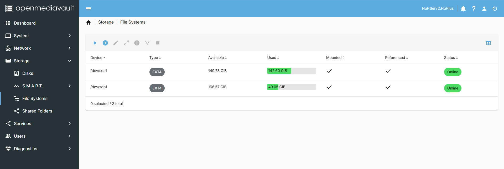
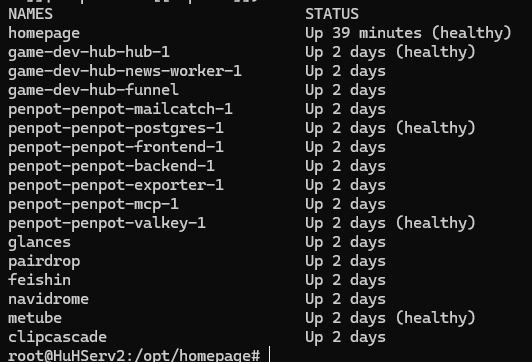
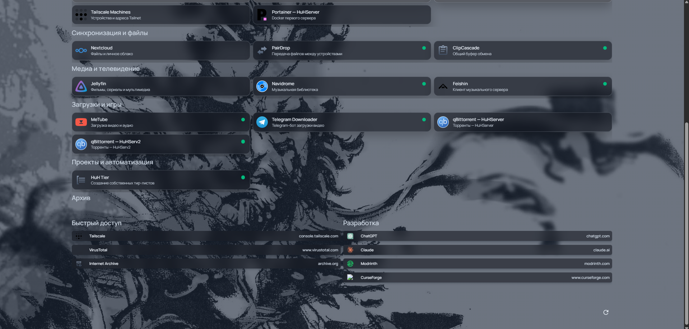
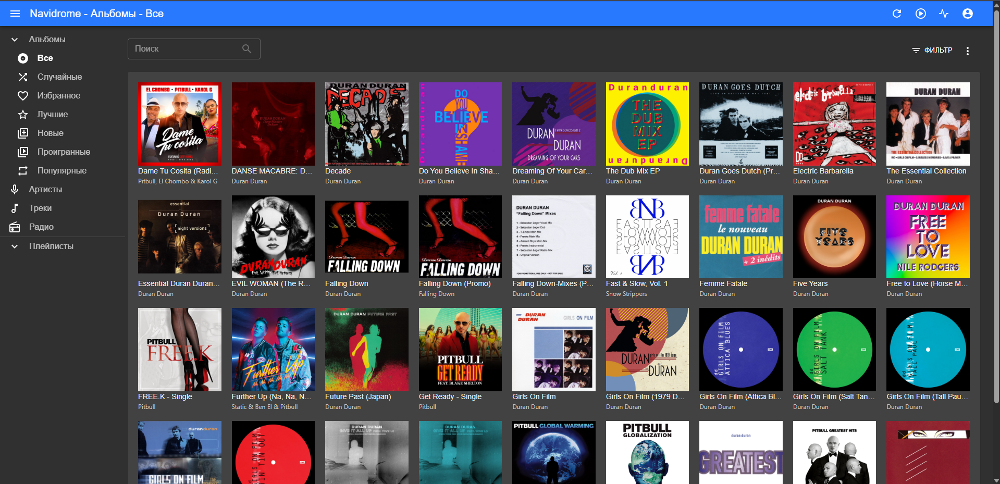
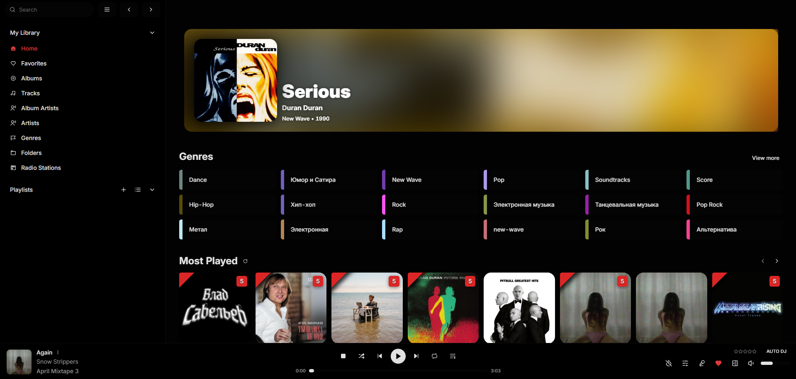
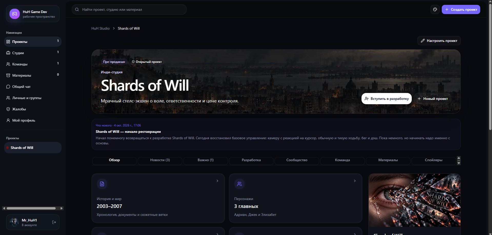

# HuHServ2 — Containerized Applications and Service Infrastructure

> **Project type:** Personal homelab  
> **Environment:** Physical x86_64 Linux server  
> **Operating system:** Debian GNU/Linux 12 (bookworm)  
> **Initial snapshot:** October 18, 2026  
> **Latest service-level verification:** October 22, 2026  
> **Scope:** System administration, Docker infrastructure, self-hosted applications, private networking, and documented troubleshooting.

---

## 1. Overview

HuHServ2 is the application-oriented node of my two-server Linux homelab.

It hosts self-managed web applications, databases, media services, development tools, monitoring utilities, and custom Docker workloads. The infrastructure is used for practical experimentation with Linux administration, container orchestration, application deployment, networking, and troubleshooting.

The project demonstrates experience in:

- Managing a physical Debian-based Linux server.
- Deploying and maintaining Docker containers.
- Working with multi-container application stacks.
- Configuring private and separately published remote access through Tailscale.
- Monitoring hardware resources and service availability.
- Organizing self-hosted applications with Homepage.
- Documenting technical investigations and troubleshooting.

**This is a personal homelab project, not a commercial production deployment.** The documentation describes observed configurations and practical administration experience; it does not claim high availability, benchmarked performance, or production-grade reliability.

---

## 2. Hardware and Operating System

The following hardware configuration was recorded during the initial inspection on October 18, 2026.

| Component | Configuration |
|---|---|
| CPU | Intel Celeron G540 @ 2.50 GHz |
| CPU architecture | x86_64 |
| Logical CPUs | 2 |
| Memory | 15 GiB reported by `free -h` |
| Operating system | Debian GNU/Linux 12 (bookworm) |
| Linux kernel | `6.12.95+deb12-amd64` |
| Docker Engine | 29.9.0 (initial snapshot) |
| Server role | Containerized applications and services |

### 2.1. Storage Layout

| Purpose | Observed disk size | Filesystem |
|---|---:|---|
| Data storage | 298.1 GB | ext4 |
| System/root disk | 232.9 GB | ext4 |
| Swap partition | 976 MB | swap |

At the time of the initial snapshot, approximately **9.1 GiB of memory was available**. These figures represent a point-in-time observation, not a storage benchmark or performance test.

### 2.2. OpenMediaVault Administration

HuHServ2 uses OpenMediaVault for storage and system administration. Its web interface provides access to filesystem information, storage configuration, system statistics, and network services.

**OpenMediaVault Dashboard**


**Filesystem Management**



---

## 3. Docker Infrastructure

Docker is the primary application deployment platform on HuHServ2. The server hosts standalone applications and multi-container workloads containing web frontends, backends, databases, workers, and other supporting components.

### 3.1. Container Inventory

The infrastructure has changed over time as applications have been installed, removed, and reorganized.

| Inspection date | Running containers |
|---|---:|
| October 18, 2026 | 42 |
| October 21, 2026 | 25 |

The October 21 inspection recorded **25 running containers**, including **9 containers reporting healthy Docker healthchecks**, multiple application stacks, and both public container images and locally built images.

A running container does not necessarily mean every application feature is working. Containers without a configured healthcheck can report `Up` without additional health information. These counts are historical observations, not continuously updated metrics.

### 3.2. Observed Workload Categories

| Category | Applications and components |
|---|---|
| Dashboard and monitoring | Homepage, Glances |
| Design and collaboration | Penpot |
| Development infrastructure | Game Dev Hub, application workers |
| Media applications | Navidrome, Feishin |
| File synchronization and sharing | PairDrop, ClipCascade |
| Downloads and automation | qBittorrent, MeTube, Telegram Downloader |
| Networking | Tailscale, AmneziaWG |
| Databases and supporting services | PostgreSQL, Valkey |
| Custom applications | Privately maintained web applications and supporting services |

Some applications use multiple containers, so container count does not equal application count. Historical services removed from the deployment are not presented as active workloads.

### 3.3. Docker Container Evidence

The following screenshot shows selected running containers and their observed states.



The screenshot focuses on infrastructure components and excludes some privately named workloads.

---

## 4. Homepage — Self-Hosted Infrastructure Dashboard

Homepage is deployed on HuHServ2 as a centralized dashboard for accessing and monitoring self-hosted applications across the homelab. It provides a single interface for navigation, service organization, and monitoring information.

### 4.1. Dashboard Features

The configured interface includes:

- Monitoring widgets for HuHServer and HuHServ2.
- Application groups organized by purpose.
- Docker and server administration shortcuts.
- File synchronization and cloud services.
- Media applications and development tools.
- Service status indicators.
- Search, date, and time widgets.

### 4.2. Custom Glassmorphism Interface

The dashboard was customized using Homepage configuration settings and additional CSS. Its personalized **Graphite Glass** appearance includes:

- Dark graphite service cards with translucent backgrounds.
- Background blur and a personalized wallpaper.
- Thin borders, rounded corners, and hover effects.
- Custom information-widget styling.
- Improved text contrast and readability.

The design was configured through `settings.yaml` and `custom.css`, without replacing Homepage or altering its core application features.

### 4.3. Homepage Screenshots

**Infrastructure Monitoring and Main Services**


**Additional Services and Navigation**



These screenshots demonstrate practical experience customizing a self-hosted infrastructure dashboard.

---

## 5. Featured Deployment — Penpot

Penpot 2.17 is deployed on HuHServ2 as a self-hosted, multi-container UI design and prototyping application.

| Component | Container image |
|---|---|
| Frontend | `penpotapp/frontend:2.17` |
| Backend | `penpotapp/backend:2.17` |
| PostgreSQL | `postgres:15` |
| Valkey | `valkey/valkey:8.1` |
| Exporter | `penpotapp/exporter:2.17` |
| MCP | `penpotapp/mcp:2.17` |
| Mailcatcher | `sj26/mailcatcher:latest` |

### 5.1. Networking

All seven containers share the `penpot_penpot` Docker bridge network. The inspected network uses the `bridge` driver and is not marked as an internal Docker network. PostgreSQL and Valkey do not have host-published ports in the observed configuration.

### 5.2. Remote Access

Penpot is accessed privately through Tailscale Serve. The verified access path is:

**Windows laptop → Tailscale Serve HTTPS :9001 → HuHServ2 loopback :9001 → Penpot Frontend :8080**

The Penpot endpoint was marked `tailnet only` during inspection and was not published through Tailscale Funnel. Other applications use separate Serve or Funnel routes.

### 5.3. Technical Case Study

The separate document covers the container architecture, image versions, Docker networking, port mappings, private remote access, Mermaid diagram, verification, screenshots, and limitations.

**[Read the Penpot Self-Hosted Deployment Case Study](penpot-deployment.md)**

*Penpot deployment verification: October 21, 2026.*

---

## 6. Other Self-Hosted Applications

### 6.1. Navidrome and Feishin — Private Music Services

Navidrome and Feishin run as **independent Docker Compose projects** on HuHServ2. The Docker container inspection on October 22, 2026 showed:

| Service | Image | Local published port | Docker network |
|---|---|---|---|
| Navidrome | `deluan/navidrome:latest` | `127.0.0.1:4533` | `navidrome_default` |
| Feishin | `ghcr.io/jeffvli/feishin:latest` | `127.0.0.1:9180` | `feishin_default` |

Both containers were running and configured with the `unless-stopped` restart policy. Local HTTP checks returned `302` for Navidrome and `200` for Feishin. Tailscale Serve exposed two **tailnet-only** HTTPS routes; neither route was marked as a public Funnel endpoint.

The browser screenshots demonstrate an album library in Navidrome and a populated music player interface in Feishin. End-to-end authenticated playback and API integration have not yet been independently tested.





**[Read the Navidrome and Feishin Technical Case Study](music-services-deployment.md)**

### 6.2. Game Dev Hub — Web Application and Background Worker

Game Dev Hub is a self-hosted workspace for organizing game development projects, studios, teams, and updates. A focused inspection was performed on **October 22, 2026**.

The deployment includes:

- Web application: `game-dev-hub-hub-1`, image `huh-game-dev-hub:1.0.0`, **Up (healthy)**.
- Background news worker: `game-dev-hub-news-worker-1`, same image, **Up**; functionality not independently verified.
- Separate Tailscale container: `game-dev-hub-funnel`, image `tailscale/tailscale:stable`, host networking.
- Docker Compose project `game-dev-hub` for the Hub and worker.
- Docker bridge network `game-dev-hub_default` for the application containers.
- Local HTTP endpoint: `127.0.0.1:8096` mapped to container port `3000`; returned **HTTP 200**.
- An enabled **public Tailscale Funnel** route to `http://127.0.0.1:8096`.

The investigation also identified a nonstandard Tailscale daemon socket at `/tmp/tailscaled.sock`. Explicitly selecting this socket allowed Serve/Funnel inspection without restarting the container.

The technical case study includes an architecture diagram, Docker and networking verification, the socket investigation, and screenshots of the project and studio interfaces. External public reachability and authorization security were not independently validated.



**[Read the Game Dev Hub Technical Case Study](game-dev-hub-deployment.md)**

### 6.3. File Sharing and Downloads

Other services include PairDrop for device-to-device transfers, ClipCascade for clipboard synchronization, MeTube for downloading video and audio, qBittorrent for download management, and Telegram Downloader for automated downloads.

These are maintained as part of the personal homelab.

---

## 7. Networking and Remote Connectivity

Tailscale is used to connect selected devices and servers across a private Tailnet, including Windows clients, Linux servers, and mobile devices.

### 7.1. Tailscale Serve

Selected self-hosted applications are made available to authorized Tailnet clients through Tailscale Serve. This permits loopback-bound services to be accessed through configured HTTPS endpoints without necessarily publishing them to the public internet.

### 7.2. Tailscale Funnel

Other applications use **Tailscale Funnel** to expose an HTTPS route publicly. Funnel exposure must be distinguished from Tailnet-only Serve and does not itself prove that application-level authorization is configured.

On October 22, the separately running Game Dev Hub Tailscale container reported an enabled Funnel proxy to the loopback-bound Hub application. The external internet path and authentication controls remain to be tested independently.

The Penpot frontend was separately verified as Tailnet-only.

### 7.3. Connectivity Limitations

The October 21 inspection reported a Tailscale DNS configuration warning involving `resolvconf`. This was not resolved as part of the portfolio documentation. Successful access to selected services does not constitute a comprehensive network reliability or security audit.

---

## 8. Administration Experience Demonstrated

### Linux Administration

- Operating Debian on physical hardware.
- Inspecting system information and resource utilization.
- Managing storage and network services.
- Using SSH and command-line administration tools.

### Docker Administration

- Inspecting running containers and images.
- Reviewing Docker healthcheck indicators.
- Working with multi-container application stacks.
- Inspecting Docker networks and host-published ports.
- Managing locally built application images.

### Networking

- Configuring remote access through Tailscale.
- Inspecting private Serve and public Funnel configurations.
- Understanding Docker port publishing and loopback-bound services.
- Distinguishing Docker networking from internet exposure.

### Documentation and Troubleshooting

- Collecting technical evidence with read-only commands.
- Documenting real infrastructure configuration and limitations.
- Building Mermaid architecture diagrams.
- Investigating the Tailscale daemon socket location.
- Organizing documentation and screenshots through Git and GitHub.

These skills were developed through practical work on a personal homelab, not claimed commercial customer engagements.

---

## 9. Evidence and Verification

Representative read-only commands used during the investigations include:

```bash
cat /etc/os-release
uname -r
lscpu
free -h
lsblk -o NAME,SIZE,TYPE,FSTYPE,MOUNTPOINTS
docker --version
docker ps
docker network ls
docker network inspect penpot_penpot
docker network inspect game-dev-hub_default
docker top game-dev-hub-funnel -eo pid,comm
tailscale status
tailscale serve status
tailscale funnel status
```

Game Dev Hub required `docker exec ... tailscale --socket=/tmp/tailscaled.sock` to query the Tailscale daemon inside its dedicated container. Its local HTTP endpoint was checked using `curl`.

### 9.1. Verification Results

| Verification | Observed result |
|---|---|
| Linux system inventory | Recorded on October 18 |
| Docker workload inventory | Recorded on October 18 and 21 |
| Running container states | Inspected |
| Penpot PostgreSQL and Valkey healthchecks | Healthy in observed snapshot |
| Penpot Docker network and ports | Inspected |
| Private Tailscale Serve route for Penpot | Verified configuration |
| Penpot project dashboard | Opened successfully |
| Homepage customization | Visually verified |
| Game Dev Hub container healthcheck | Healthy in observed snapshot |
| Game Dev Hub Docker Compose labels and network | Inspected |
| Game Dev Hub local HTTP response | **200 OK** |
| Game Dev Hub Tailscale Funnel | Configured and enabled |
| Game Dev Hub Tailscale socket diagnosis | Confirmed `/tmp/tailscaled.sock` |
| Game Dev Hub project and studio interfaces | Screenshots captured |
| Navidrome and Feishin Docker and Compose metadata | Inspected on October 22 |
| Navidrome and Feishin local HTTP | `302` / `200`, respectively |
| Navidrome and Feishin Tailscale Serve | Both routes marked tailnet only |
| Navidrome and Feishin application interfaces | Screenshots captured |

These are dated observations, not an uptime guarantee, security audit, or performance certification.

---

## 10. Planned Improvements

- [x] Document the physical server configuration.
- [x] Record Docker container inventory snapshots.
- [x] Capture screenshots of infrastructure and selected applications.
- [x] Customize the Homepage interface.
- [x] Document the Penpot deployment and Tailnet-only Serve configuration.
- [x] Document Game Dev Hub containers, networking, Funnel configuration and socket troubleshooting.
- [x] Document the Navidrome and Feishin deployment and Tailnet-only access.
- [ ] Verify Feishin-to-Navidrome playback end to end.
- [ ] Document sanitized Docker Compose examples.
- [ ] Measure resources under normal workloads.
- [ ] Verify OpenMediaVault installation details.
- [ ] Test and document backup and recovery procedures.
- [ ] Verify Game Dev Hub external reachability and access controls.
- [ ] Check Game Dev Hub background worker job behavior.
- [ ] Investigate outstanding Tailscale DNS warnings.
- [ ] Record additional real troubleshooting cases.
- [ ] Create a complete two-server architecture overview.

---

## 11. Security and Disclosure

This repository documents personal infrastructure. Credentials, access tokens, private keys, and complete internal network configurations are not intentionally included in published technical descriptions.

Published screenshots and diagrams should be reviewed for private project information, addresses, hostnames, and other sensitive details. A configured public Funnel route does not mean that application authentication and authorization have been verified.

The presence of running containers or VPN services is not evidence of a completed security assessment. Information is provided to document hands-on Linux administration experience.

---

## Maintainer

**Vyacheslav Sadovsky (MrHuH)**  
Linux Server Administration | Debian | Docker | Self-Hosting | Networking

**GitHub:** [sadovskijslava](https://github.com/sadovskijslava)  
**Repository:** [homelab-infrastructure](https://github.com/sadovskijslava/homelab-infrastructure)

*Personal homelab project — not a commercial client deployment.*
