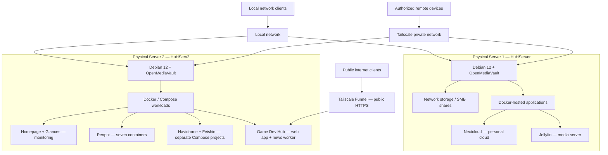

# HomeLab — Two-Server Infrastructure Architecture

> **Project:** Personal homelab  
> **Environment:** Two physical Debian GNU/Linux 12 servers  
> **Documentation snapshot:** October 22, 2026  
> **Scope:** Logical component architecture based on documented deployments and observed routing. Not a physical cabling map or security certification.

## 1. Overview

The homelab is organized around two physical Linux servers with different primary roles:

- **HuHServer:** Storage-oriented node providing OpenMediaVault administration, network file sharing, Nextcloud, Jellyfin, and Docker-based services.
- **HuHServ2:** Application-oriented node providing Docker workloads, monitoring, design tools, the Game Dev Hub, and music services.

Both are connected to the local network and use Tailscale for selected remote-access workflows. Private **Tailscale Serve** routes and separately configured public **Tailscale Funnel** routes must be distinguished.

## 2. Logical Architecture Diagram

**Diagram interpretation:** Arrows from server nodes to application groups represent logical hosting, not direct network flows. The diagram does **not** assert untested cross-server dependencies, shared storage mounts, communication between app components, or specific router/switch wiring. The private Tailnet links illustrate remote connectivity to server nodes, not unrestricted access to every application.

## 3. Host Responsibilities

| Area | HuHServer | HuHServ2 |
|---|---|---|
| Primary role | Storage, cloud, and media | Application deployments and development tools |
| OS | Debian GNU/Linux 12 | Debian GNU/Linux 12 |
| Administration | OpenMediaVault, Linux CLI, SSH | OpenMediaVault, Linux CLI, SSH |
| Containers | Docker-hosted services | Docker and Docker Compose workloads |
| Selected applications | Nextcloud, Jellyfin | Homepage, Glances, Penpot, Game Dev Hub, Navidrome, Feishin |
| Connectivity | Local network; selected Tailscale connectivity | Local network; selected Tailscale Serve and Funnel routes |

Running-container counts, disk usage, and application versions are intentionally excluded from this overview because they change and are documented in dated, host-specific inventories.

## 4. Verified Access Patterns on HuHServ2

| Service | Observed access | Scope | Evidence |
|---|---|---|---|
| Penpot frontend | HTTPS `:9001` → loopback `:9001` → container `:8080` | Tailscale Serve, **tailnet only** | [Penpot deployment](penpot-deployment.md) |
| Navidrome | HTTPS `:4533` → `localhost:4533` | Tailscale Serve, **tailnet only** | [Music services](music-services-deployment.md) |
| Feishin | HTTPS `:9180` → `localhost:9180` | Tailscale Serve, **tailnet only** | [Music services](music-services-deployment.md) |
| Game Dev Hub | Public HTTPS → host `127.0.0.1:8096` → Hub container `:3000` | **Tailscale Funnel enabled** | [Game Dev Hub deployment](game-dev-hub-deployment.md) |

The observed Funnel configuration enables public exposure for Game Dev Hub, but external reachability and application-level authentication/authorization were not independently validated as part of the case study. HTTPS transport alone does not establish application-level authorization.

## 5. Selected Docker Network Boundaries on HuHServ2

- **Penpot:** Seven containers on the `penpot_penpot` bridge network. PostgreSQL and Valkey were not published to host ports in the inspected configuration.
- **Game Dev Hub:** Web app and news worker on `game-dev-hub_default`; dedicated Tailscale container uses host networking. No unverified application-level calls are shown between worker and Hub.
- **Navidrome and Feishin:** Separate Compose projects and bridge networks (`navidrome_default` and `feishin_default`). Their client-to-server API path was not independently traced.

A Docker bridge network does not, by itself, constitute a security boundary against all network paths. Host port mappings and remote proxy configurations must be considered separately.

## 6. Operational Evidence

The architecture is supported by dated checks documented in individual case studies:

- Docker container status, images, Compose labels, ports, and network membership.
- Tailscale Serve/Funnel route inspection and a real Tailscale Unix-socket troubleshooting case.
- Local HTTP checks: Game Dev Hub `200`, Feishin `200`, Navidrome `302` (redirect), on October 22, 2026.
- Screenshots of OpenMediaVault, Homepage, application interfaces, and selected Docker evidence.

### Screenshots

**Server monitoring and service dashboard**

**HuHServer storage administration**

**HuHServ2 storage administration**

## 7. Further Verification Needed

- [ ] Map the exact physical cable/switch/router connections and link speeds.
- [ ] Confirm which storage volumes, if any, are mounted across the two hosts.
- [ ] Document firewall policy and Tailnet access-control rules, with sensitive identifiers removed.
- [ ] Verify backup and restoration procedures for critical application data.
- [ ] Perform an off-Tailnet test of the intended Game Dev Hub public endpoint and review its authentication/authorization controls.
- [ ] Test Feishin-to-Navidrome authenticated playback and capture the actual API route if relevant.
- [ ] Document system monitoring, operational alerting, and maintenance practices with concrete evidence.

## 8. Documentation Index

- [HuHServer — Storage and Self-Hosted Services](huhserver.md)
- [HuHServ2 — Containerized Application Infrastructure](huhserv2.md)
- [Penpot Deployment](penpot-deployment.md)
- [Game Dev Hub Deployment](game-dev-hub-deployment.md)
- [Navidrome and Feishin](music-services-deployment.md)

---

**Maintainer:** [Vyacheslav Sadovsky (MrHuH)](https://github.com/sadovskijslava)  
**Repository:** [homelab-infrastructure](https://github.com/sadovskijslava/homelab-infrastructure)

*Personal homelab case study — not a commercial deployment or security audit.*
