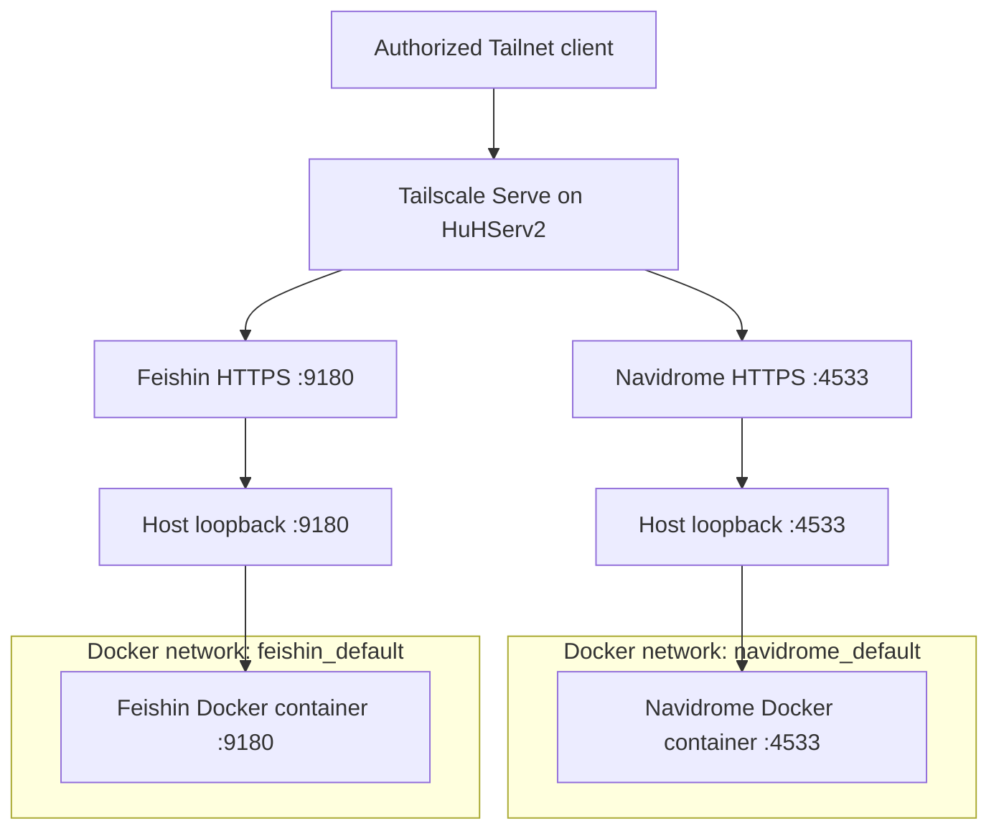

# Music Services — Navidrome and Feishin on HuHServ2

> **Project type:** Personal homelab  
> **Host:** HuHServ2 (Debian GNU/Linux 12)  
> **Inspection date:** October 22, 2026  
> **Scope:** Observed Docker deployments, network separation, local HTTP behavior, private Tailscale Serve routes, and application screenshots. Not a production availability or security assessment.

---

## 1. Overview

HuHServ2 hosts **Navidrome**, a self-hosted music server, and **Feishin**, a separate browser-based music player and library interface.

Both applications run in Docker and expose their host ports exclusively through the loopback interface. Remote HTTPS access is configured with **Tailscale Serve**, with routes marked **tailnet only**. No public Tailscale Funnel route was shown for either service in the inspected configuration.

This case study documents container management, port mappings, network isolation boundaries, Compose metadata, basic HTTP diagnostics, and evidence from the user interfaces.

## 2. Container Inventory

The following information was collected using `docker ps` and `docker inspect` on October 22, 2026.

| Property | Navidrome | Feishin |
|---|---|---|
| Container name | `navidrome` | `feishin` |
| Image | `deluan/navidrome:latest` | `ghcr.io/jeffvli/feishin:latest` |
| Observed state | Up 3 days | Up 3 days |
| Host port mapping | `127.0.0.1:4533->4533/tcp` | `127.0.0.1:9180->9180/tcp` |
| Additional exposed container port | — | `8080/tcp` (no host mapping shown) |
| Docker network | `navidrome_default` | `feishin_default` |
| Compose project / service | `navidrome` / `navidrome` | `feishin` / `feishin` |
| Restart policy | `unless-stopped` | `unless-stopped` |

**Notes:** Both containers reported `Up`; no `healthy` Docker healthcheck status was shown in the provided output. The `latest` image tags do not establish exact application versions.

## 3. Docker Networking and Host Exposure

Navidrome and Feishin are managed as **two separate Docker Compose projects** and connect to **different Docker networks**:

- `navidrome` → `navidrome_default`
- `feishin` → `feishin_default`

The host port mappings use `127.0.0.1`. As a result, these ports are not bound directly to every host interface, although separately configured reverse proxies or Tailscale Serve can still make them accessible.

The containers' membership in different networks does not, by itself, demonstrate direct inter-container connectivity. The Feishin-to-Navidrome API path and its authentication settings were not separately inspected.

## 4. Local HTTP Verification

Read-only checks from the HuHServ2 host:

```bash
curl -sS -o /dev/null \
  -w 'Navidrome HTTP: %{http_code}\n' \
  --max-time 10 http://127.0.0.1:4533/

curl -sS -o /dev/null \
  -w 'Feishin HTTP: %{http_code}\n' \
  --max-time 10 http://127.0.0.1:9180/
```

| Endpoint | Observed HTTP response | Interpretation |
|---|---|---|
| Navidrome (`:4533`) | `302` | Redirect returned; its destination was not separately captured in this command |
| Feishin (`:9180`) | `200` | Successful local HTTP response |

The browser screenshots also show populated music interfaces. These observations establish basic responsiveness, **not an end-to-end playback benchmark or complete application health assessment**.

## 5. Private HTTPS Access with Tailscale Serve

The inspected host-level Tailscale configuration included the following **Tailnet-only** routes:

```text
https://<tailnet-host>:4533 (tailnet only)
|-- / proxy http://localhost:4533

https://<tailnet-host>:9180 (tailnet only)
|-- / proxy http://localhost:9180
```

This configuration differs from **Tailscale Funnel**, which can expose applications to the public internet. The observed routes for Navidrome and Feishin are private to permitted Tailnet clients; actual permissions depend on the Tailnet's access policies.

### 5.1. Verified Access Architecture



The diagram shows observed ingress and container network membership. It intentionally does not draw an unverified application-level data connection between the two services.

## 6. Application Screenshots

### 6.1. Feishin — Music Client

The observed Feishin interface includes library navigation, music genres, frequently played albums, and player controls.


### 6.2. Navidrome — Music Library

The observed Navidrome interface displays an organized album collection with cover artwork, artists, navigation, and search/filter controls.


Screenshots were captured on October 22, 2026 and are point-in-time visual evidence rather than proof of uninterrupted service.

## 7. Verification and Administrative Skills Demonstrated

- Inspected Docker container names, images, uptime states, and published ports.
- Identified distinct Compose projects using Docker labels.
- Verified individual Docker network memberships.
- Inspected automatic restart policies (`unless-stopped`).
- Tested HTTP responses of loopback-bound services with `curl`.
- Inspected HTTPS reverse-proxy routes provided by Tailscale Serve.
- Verified that both application interfaces displayed content in a browser.
- Prepared sanitized screenshots and technical documentation for GitHub.

## 8. Follow-Up Tasks

- [x] Record Docker container configuration and published ports.
- [x] Verify local HTTP responses.
- [x] Inspect Tailscale Serve routes and access classifications.
- [x] Capture screenshots of both application interfaces.
- [ ] Confirm the Navidrome redirect target and complete redirected HTTP flow.
- [ ] Test authenticated Feishin-to-Navidrome API integration and audio playback end to end.
- [ ] Record exact Navidrome and Feishin image digests or application versions.
- [ ] Document sanitized Compose configurations, storage mounts, and update procedures.
- [ ] Verify media backups and restoration procedures.
- [ ] Review access policies and application authentication without publishing credentials.

## 9. Security and Scope

This is a **personal homelab deployment**, not a commercial client installation. No credentials, access tokens, library filesystem paths, or private Tailnet identity details are intentionally disclosed.

Running containers, private HTTPS routing, and a successful HTTP response do not by themselves establish application security, high availability, or successful disaster recovery.

---

**Maintainer:** [Vyacheslav Sadovsky (MrHuH)](https://github.com/sadovskijslava)  
**Repository:** [homelab-infrastructure](https://github.com/sadovskijslava/homelab-infrastructure)  
*Documentation snapshot: October 22, 2026.*
