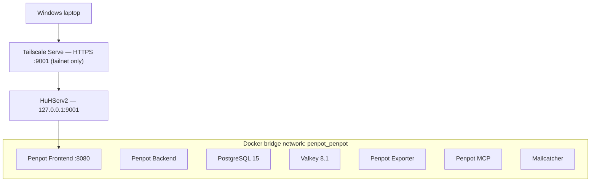
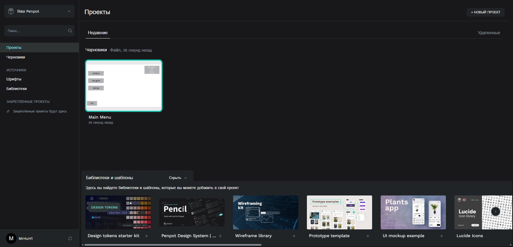

# Penpot — Self-Hosted Multi-Container Deployment

> **Project:** Personal homelab  
> **Host:** HuHServ2 — Debian 12  
> **Application:** Penpot 2.17  
> **Documentation snapshot:** October 21, 2026  
> **Scope:** Observed configuration and basic operational checks, not a production security audit.

## 1. Overview

This project documents a self-hosted Penpot deployment on HuHServ2. Penpot is used for UI design and prototyping. The deployment consists of seven Docker containers sharing one bridge network, with remote access to the frontend provided through Tailscale Serve.

The goal of this case study is to demonstrate practical experience with Docker-based application deployment, container networking, access configuration, and system verification.

## 2. Container Infrastructure

| Component | Container image | Observed status |
| --- | --- | --- |
| Frontend | `penpotapp/frontend:2.17` | Up |
| Backend | `penpotapp/backend:2.17` | Up |
| PostgreSQL | `postgres:15` | Up (healthy) |
| Valkey | `valkey/valkey:8.1` | Up (healthy) |
| Exporter | `penpotapp/exporter:2.17` | Up |
| MCP | `penpotapp/mcp:2.17` | Up |
| Mailcatcher | `sj26/mailcatcher:latest` | Up |

At the time of inspection, all seven containers had been running for approximately two days. Only PostgreSQL and Valkey explicitly reported a healthy Docker healthcheck. The other `Up` statuses do not, by themselves, prove application health.

## 3. Docker Network and Ports

All seven containers belong to the same Docker network:

| Network property | Observed value |
| --- | --- |
| Name | `penpot_penpot` |
| Driver | `bridge` |
| Internal | `false` |
| Connected Penpot containers | 7 |

The following ports were observed in `docker ps`:

| Service | Port configuration | Interpretation |
| --- | --- | --- |
| Frontend | `127.0.0.1:9001 -> 8080/tcp` | Published on the host loopback interface |
| Mailcatcher web UI | `127.0.0.1:1080 -> 1080/tcp` | Published on the host loopback interface |
| Mailcatcher SMTP | `1025/tcp` | No host port published in the observed output |
| PostgreSQL | `5432/tcp` | No host port published in the observed output |
| Valkey | `6379/tcp` | No host port published in the observed output |
| Backend, Exporter, MCP | No port mappings shown | No host-published ports shown in the observed output |

The network is **not** marked internal; membership in a bridge network is not evidence of complete isolation. Published ports alone also do not determine whether an application is reachable through a separate proxy or tunnel.

## 4. Private Remote Access with Tailscale

The Penpot frontend is accessed from a Windows laptop through **Tailscale Serve**:

- Tailscale Serve exposes an HTTPS endpoint on port `9001` to permitted Tailnet clients.
- That endpoint proxies to `http://127.0.0.1:9001` on HuHServ2.
- Docker forwards that loopback port to port `8080` in the Penpot frontend container.
- The observed Tailscale configuration marked this endpoint as **tailnet only**, not as a public Funnel route.

Other services on the same server have separate Serve/Funnel routes. Those routes are outside the scope of this Penpot deployment case study.

## 5. Architecture Overview

**Diagram scope:** The Tailscale-to-frontend route and shared Docker network membership were verified. The diagram intentionally does not invent unverified communication paths among the Penpot components.

## 6. Verification Performed

- Inspected the running Penpot containers using `docker ps`.
- Verified membership of all seven containers in `penpot_penpot` using `docker inspect`.
- Inspected the network driver and `Internal` setting using `docker network inspect`.
- Checked host-published port mappings.
- Inspected Tailscale Serve and Funnel routing.
- Opened the authenticated Penpot project dashboard in a browser.

## 7. Screenshot

### Penpot Project Dashboard

The authenticated project view of the self-hosted Penpot instance:

## 8. Notes and Limitations

This is a **personal homelab deployment**, not a commercial client installation. The screenshots and command outputs document observed behavior at the stated date, not an uptime guarantee or a complete security assessment.

No credentials, access tokens, private keys, or complete Tailnet inventory are included in this public document.
